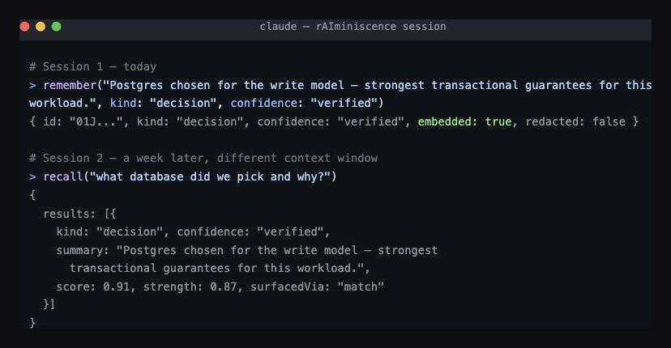
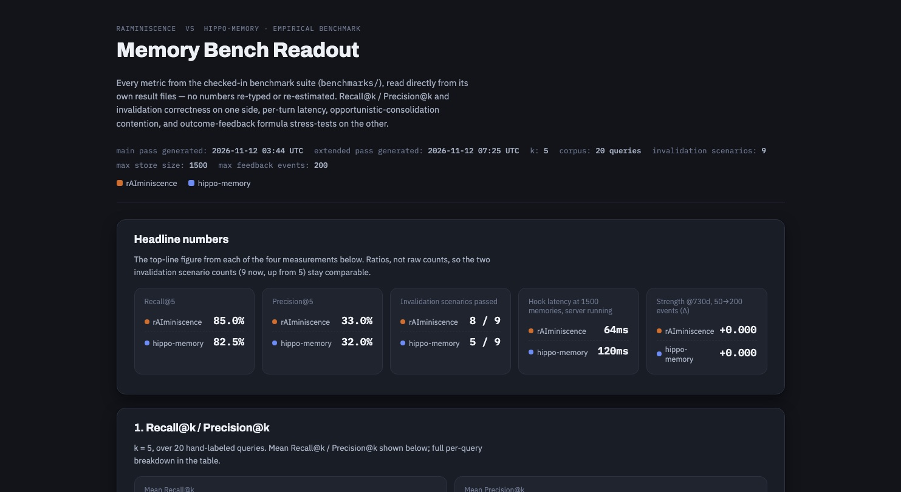

# rAIminiscence

[](https://www.npmjs.com/package/raiminiscence-mcp)
[](https://github.com/windagency/raiminiscence/actions/workflows/ci.yml)
[](https://nodejs.org)
[](./LICENSE)

**Persistent memory for AI coding agents. An MCP server for Claude Code, Cursor and Codex CLI that runs locally, stores plain files, and lets stale knowledge fade.**

Your agent forgets everything when a session ends. It re-asks why you chose Postgres. It repeats the mistake you corrected last week. rAIminiscence gives it a memory that lasts across sessions: the agent calls `remember` when it learns something and `recall` when it needs it. Useful memories grow stronger. Outdated ones fade or get retired when your code moves on.

- **Two commands to install.** No database, no vector store, no service to run, no API key.
- **Private by default.** Memories are Markdown files in your project, gitignored. Embeddings run on your machine.
- **Measured, not claimed.** On two published research benchmarks it matches or beats [hippo-memory](https://github.com/kitfunso/hippo-memory), with its per-turn hook about twice as fast.

[Quick start](#quick-start) · [Why it exists](#why-it-exists) · [How it compares](#how-it-compares) · [How it works](#how-it-works) · [Documentation](#documentation)



<sub>Illustration of documented output. rAIminiscence has no GUI; it works inside your agent.</sub>

## Quick start

Requires Node.js 22 or later.

**1. Install the server.**

```bash
npm install -g raiminiscence-mcp      # npm
pnpm add -g raiminiscence-mcp         # pnpm
yarn global add raiminiscence-mcp     # Yarn 1
bun add -g raiminiscence-mcp          # Bun
```

Yarn 2 and later have no global installs. Skip this step: the command in step 2 fetches the server on first start. Bun installs the package, but the server still runs on Node.js.

**2. Register it with your client.**

```bash
claude mcp add raiminiscence -- npx raiminiscence-mcp
```

`npx` ships with Node.js, so this works with any package manager. If npm did not install the server, `npx` fetches its own copy on first start.

In Claude Code, the plugin marketplace in this repository does the same in place of that command:

```
/plugin marketplace add windagency/raiminiscence
/plugin install raiminiscence@raiminiscence
```

The plugin registers the server only. The hooks in step 3 are a separate install.

<details>
<summary>Cursor and Codex CLI</summary>

**Cursor:** add to `.cursor/mcp.json` in your project, or `~/.cursor/mcp.json` for every project.

```json
{
  "mcpServers": {
    "raiminiscence": { "type": "stdio", "command": "npx", "args": ["raiminiscence-mcp"] }
  }
}
```

**Codex CLI:** add to `~/.codex/config.toml`, or `<repo>/.codex/config.toml` for one project.

```toml
[mcp_servers.raiminiscence]
command = "npx"
args = ["raiminiscence-mcp"]
```

</details>

**3. Optional: let memory arrive on its own.** The hooks package primes each session with what the project already knows, and adds relevant memories to every prompt. The agent no longer has to think of asking.

```bash
npm install -g raiminiscence-hooks      # npm
pnpm add -g raiminiscence-hooks         # pnpm
yarn global add raiminiscence-hooks     # Yarn 1
bun add -g raiminiscence-hooks          # Bun

raiminiscence-hooks-install --client=claude-code   # or cursor, codex
```

The hooks need a global install, which Yarn 2 and later don't offer. Use npm, pnpm or Bun there.

The embedding model downloads once, on first use. After that, everything runs offline. Full setup, options and troubleshooting: **[user guide](./docs/user-guide.md)**.

## See it work

```plaintext
> remember("Postgres chosen for the write model — strongest transactional guarantees for this workload.", kind: "decision", confidence: "verified")
{ id: "01J...", kind: "decision", confidence: "verified", embedded: "pending", redacted: false }
```

A week later, in a new session:

```plaintext
> recall("what database did we pick and why?")
{ results: [{ summary: "Postgres chosen for the write model — strongest transactional guarantees for this workload.", score: 0.91, strength: 0.87, surfacedVia: "match" }] }
```

## Why it exists

[hippo-memory](https://github.com/kitfunso/hippo-memory) proved the idea: agent memory should behave like human memory, fading unless it keeps proving useful. rAIminiscence started from that idea and one question. What is the smallest thing that is real memory for one developer, one project and one agent?

hippo-memory answers a bigger question. It is infrastructure for fleets of agents, tools and tenants, with a SQLite store, an HTTP API and multi-tenant auth. A single developer pays for that scope in setup, moving parts, and a store that needs tools to read. rAIminiscence keeps the biology and drops the infrastructure.

### What it does differently

- **Your memory is files you can read.** Each memory is a Markdown file in your project. Read it, grep it, diff it, review it in a pull request. There is no database to open and nothing to host.
- **Outdated knowledge leaves the ranking.** Once a memory is stale, `recall` stops returning it. When a commit says "migrate from webpack to vite", memories about webpack go stale. So do memories anchored to files that a later commit changed.
- **Four kinds of memory, four lifetimes.** Each kind has its own half-life: 7 days for a passing observation, 21 for a decision, 30 for a pattern distilled from many observations, and 3 for a note on what you were in the middle of.
- **Mistakes stick, breaks are free.** A corrected error starts with twice the lifetime of a routine fact. The first two weeks without use cost a memory nothing, so a holiday erases nothing.
- **Usefulness keeps a memory alive, within limits.** Positive feedback extends a memory's life up to a ceiling, so a few popular memories never crowd out the rest.
- **Disagreements are surfaced, never settled silently.** When two memories may contradict each other, the agent is told and decides. Patterns built from evidence are re-checked when that evidence later changes.
- **It explains itself.** `inspect` shows why a memory ranks where it does: its strength, its lifetime, and what reinforced it.
- **It works beside your docs, not over them.** `CLAUDE.md`, `AGENTS.md` and your ADRs stay the human-curated truth. rAIminiscence holds what the agent learns along the way and never writes to them.
- **Teams share over git.** Opt in, and memories sync through a dedicated branch of your own repository. No server, no accounts.

### The design choices side by side

| | rAIminiscence | hippo-memory 3.5.1 |
| --- | --- | --- |
| Built for | One developer, one project, one agent | Fleets of agents, tools and tenants |
| Storage | Markdown files in your project | A SQLite database |
| Runs as | A subprocess your client starts, over stdio | A CLI, plus an HTTP server |
| An outdated memory | Leaves the ranking | Has its half-life halved, and can still be recalled |
| What retires a memory | Commit messages, and changes to the files it is anchored to | Commit messages, or a pattern given by hand |
| Useful after two years, 50 positive signals | Strength 0.036 | Strength 0.000 |

The last row comes from running each system's own strength formula, in [`benchmarks/results/2026-09-15-extended-results.md`](./benchmarks/results/2026-09-15-extended-results.md). The rest was checked against hippo-memory 3.5.1's published package on 2026-11-13.

## What you get

| Tool          | What it does for the agent                                                                       |
| ------------- | ------------------------------------------------------------------------------------------------ |
| `remember`    | Saves a decision, a pattern, or a corrected mistake.                                             |
| `recall`      | Finds what was already decided or tried, before the agent repeats it.                            |
| `overview`    | A short primer of standing project knowledge, plus what you were last in the middle of.          |
| `forget`      | Retracts a memory that turned out to be wrong.                                                   |
| `feedback`    | Reports whether a recalled memory helped. Helpful ones last longer; unhelpful ones fade.          |
| `conflict`    | Settles two memories that disagree: both stand, one replaces the other, or no conflict.          |
| `consolidate` | Merges related observations into one durable pattern, and prunes what has faded. Also automatic. |
| `inspect`     | Explains why a memory ranks where it does. Read-only. Also a CLI, `raiminiscence-inspect`.       |

## How it compares

Design is one half of the case. The other is measurement. Both systems were installed and run side by side against hippo-memory 3.5.1, the latest release, on 2026-11-12. The public benchmarks ran through hippo-memory's own harnesses and scorers, unchanged.

| Benchmark                                               | rAIminiscence | hippo-memory | Verdict                 |
| ------------------------------------------------------- | ------------- | ------------ | ----------------------- |
| [LoCoMo](https://github.com/snap-research/locomo), R@5  | **60.5%**     | 56.5%        | Ahead, +3.9 points      |
| [LongMemEval-S](https://arxiv.org/abs/2407.15811), R@1  | 87.6%         | 87.6%        | Level                   |
| LongMemEval-S, every evidence session in the top 5      | **86.2%**     | 83.2%        | Ahead, +3.0 points      |
| Retiring outdated memories, 9 scenarios                 | **8 of 9**    | 5 of 9       | Ahead                   |
| Coding-agent corpus, R@5                                | **85.0%**     | 82.5%        | Slightly ahead          |
| Per-turn hook, 1,500 memories stored                    | **59 ms**     | 127 ms       | About twice as fast     |

hippo-memory runs with its MiniLM embeddings on the public benchmarks. "Ahead" means the 95% confidence interval excludes a tie. Across all 28 checks of the benchmark gate, no metric is plausibly more than 3 points behind.

**Where hippo-memory is stronger:** writing many memories in bulk is several times cheaper, it wins on LongMemEval's 30 preference questions, and its hook time stays flat as the store grows. It is also the larger project, with features outside this comparison.

The full story, in plain language with per-category breakdowns and limits: **[comparison report](./benchmarks/COMPARISON.md)**. Method, raw results and history: [`benchmarks/`](./benchmarks/README.md).



## How it works

Every memory belongs to one of four kinds, each with its own half-life:

| Kind         | Half-life | Holds                                                                  |
| ------------ | --------- | ---------------------------------------------------------------------- |
| `episodic`   | 7 days    | A raw observation from one session. The default.                       |
| `semantic`   | 30 days   | A reusable pattern, usually distilled from several episodic memories.  |
| `decision`   | 21 days   | A design choice with its rationale.                                    |
| `checkpoint` | 3 days    | What you were in the middle of. Refreshed, not accumulated.            |


`recall` ranks by meaning and keywords together, weighted by each memory's current strength and how far it is trusted. Consolidation then runs on its own: it merges clusters into patterns, re-checks them against new evidence, retires what commits made obsolete, and deletes what has faded.


Each memory is one Markdown file with YAML frontmatter under `.raiminiscence/memory/`. You can read, grep and diff it. The server is a subprocess your client starts, speaking MCP over stdio only.

Formulas, thresholds and every step in detail: **[how it works](./docs/how-it-works.md)**.

## Client support

| Feature                          | Claude Code | Cursor | Codex CLI |
| -------------------------------- | ----------- | ------ | --------- |
| The eight MCP tools              | Yes         | Yes    | Yes       |
| Primer at session start          | Yes         | Yes    | Yes       |
| Relevant memories on every turn  | Yes         | No     | Yes       |
| Checkpoint reminder              | Yes         | Yes    | No        |
| Reminder to save a fix           | Yes         | No     | No        |

Claude Code is validated end to end. For Cursor and Codex CLI, the hook contract is tested in CI against the built binary. Cursor's per-turn hook cannot inject context, which is why it has no per-turn memories. Details per client: [`raiminiscence-hooks`](./packages/raiminiscence-hooks).

## FAQ

**Does it send my code or memories anywhere?** No. Memories stay in your project folder. The only network call is the one-time model download. Ollama is supported as an opt-in alternative if you already run it.

**Will it clutter my repository?** The store is gitignored by default. Sharing it with a team is an explicit opt-in.

**What if a memory is wrong?** The agent calls `forget`, or reports it through `feedback`. Memory files are written only by the tools, so every change goes through the same rules.

**How is this different from a `CLAUDE.md` or `AGENTS.md` file?** Those hold rules a human curates. rAIminiscence holds what the agent learns along the way, ranks it by relevance, and lets it fade. It writes only to its own store, never to your docs, so the two work together.

## Documentation

| Doc                                                   | For                                                                  |
| ----------------------------------------------------- | -------------------------------------------------------------------- |
| **[User guide](./docs/user-guide.md)**                | Install, configure, every tool and option, troubleshooting.          |
| **[How it works](./docs/how-it-works.md)**            | Memory kinds, strength, consolidation, conflicts, storage.           |
| **[Comparison report](./benchmarks/COMPARISON.md)**   | The benchmark results against hippo-memory, in plain language.      |
| **[Domain glossary](./CONTEXT.md)**                   | One definition per term.                                             |
| **[Developer guide](./docs/developer-guide.md)**      | Repo layout, packages, adding a tool, testing.                       |
| **[Architecture](./docs/architecture/hld.md)**        | High-level design, with the [low-level design](./docs/architecture/lld.md) and [ADRs](./docs/adr/). |

## Contributing

Contributions are welcome. Start with [`CONTRIBUTING.md`](./CONTRIBUTING.md) for the coding rules and the definition of done, and [`GOVERNANCE.md`](./GOVERNANCE.md) for how decisions are made. AI agents working in this repo follow [`AGENTS.md`](./AGENTS.md).

```bash
pnpm install && pnpm build && pnpm test
```

## Security

Report a vulnerability as described in [`SECURITY.md`](./SECURITY.md).

## License

[MIT](./LICENSE). Dependency licences are in [`THIRD_PARTY_LICENSES.md`](./THIRD_PARTY_LICENSES.md). Changes are listed in [`CHANGELOG.md`](./CHANGELOG.md). Community expectations are in [`CODE_OF_CONDUCT.md`](./CODE_OF_CONDUCT.md).
